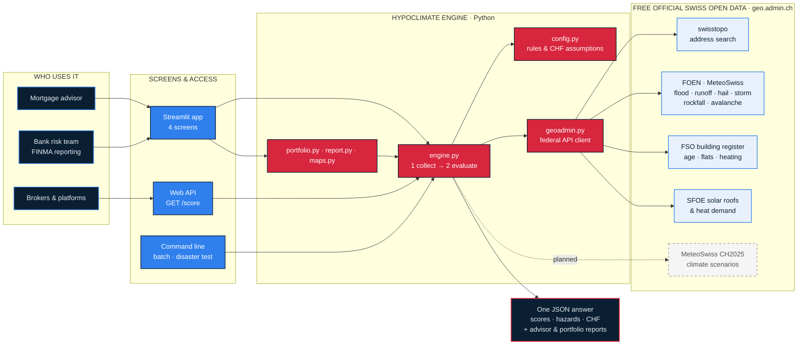
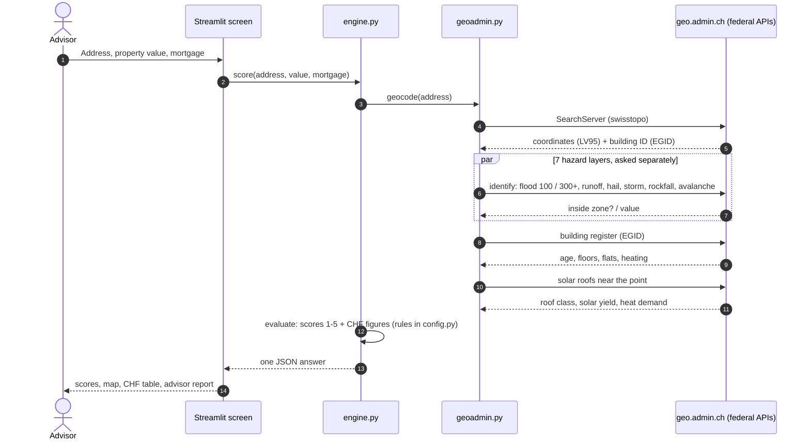

<h1 align="center">🏠🌦️ HypoClimate</h1>

  <b>Climate risk of any Swiss address, in CHF, for mortgages.</b> 
  Flood, heavy rain, hail, storm, rockfall and avalanche, plus heating and CO₂, built only on free, official Swiss open data.

  
  
  
  

  <a href="#about">About</a> &nbsp;·&nbsp; <a href="#architecture">Architecture</a> &nbsp;·&nbsp; <a href="#data">Data</a> &nbsp;·&nbsp; <a href="#screens">Screens</a> &nbsp;·&nbsp; <a href="#build-plan">Build plan</a>

---

## 🌍 What is HypoClimate?

A user types in a Swiss address. HypoClimate asks several federal data sources about that spot and shows, in one view:

- 🌊 **Natural hazards today**: river flooding, surface runoff after heavy rain, hail, storm, rockfall and avalanches
- 🏢 **The building**: age, flats and heating system from the federal building register, plus roof solar potential
- 🔥 **Transition risk**: how exposed the building is to the move away from oil and gas heating
- 📈 **The 50-year trend**: how heavy rain changes if warming rises
- 💰 **What it means in CHF**: value discount in a flood zone, loan-to-value, CO₂ levy, heat-pump cost, solar income

**Why now:** FINMA Circular 2026/1 "Nature-related financial risks" requires banks to assess climate risks in their mortgage books. In Switzerland, physical damage to buildings is mostly covered by mandatory building insurance, so the real risks for banks and owners are **lost property value, transition costs and uninsured costs**. HypoClimate focuses on exactly these.

## 🏗️ Architecture

One Python engine does all the work. The screens, the web API and the command-line tools only call that engine and show its **one JSON answer**, so every number is calculated in one place.

<b>The parts and how they connect</b>

| Part | File | Talks to | Job |
|---|---|---|---|
| Screens | `app.py` | engine, portfolio, report, maps | Address check · Bank portfolio · Method & data · Tests |
| Web API | `api.py` | engine | `GET /score` for brokers, platforms or another front end |
| Command line | `batch.py`, `disaster_test.py` | engine | Score a CSV of addresses; check real disaster places |
| Engine | `engine.py` | geoadmin, config, example data | Step 1 collects facts, step 2 turns them into scores and CHF figures |
| Rules | `config.py` | – | Every threshold and CHF assumption, in one place |
| API client | `geoadmin.py` | geo.admin.ch | Address search, hazard layers, building register, solar roofs |
| Portfolio | `portfolio.py` | engine | Scores a whole mortgage book and sums it up |
| Reports | `report.py` | – | Printable advisor report and portfolio report |
| Maps | `maps.py` | swisstopo tiles in the browser | Map with switchable federal hazard layers |
| Example data | `example_data.py`, `example_portfolio.py` | – | Offline demo; the example mortgage book is invented |

### 🔄 What happens when an advisor checks an address

The seven hazard layers are asked **separately and at the same time**. If one layer fails, only that hazard shows "No data" and the screen names the source that failed.

## 🗺️ Data sources

All data is official, free and covers all of Switzerland (geo.admin.ch, open government data).

| Data | Provider | Layer | Used for |
|---|---|---|---|
| Address search | swisstopo | SearchServer | Coordinates and building ID (EGID) |
| River flood areas 100 / 300-yr+ | FOEN | `ch.bafu.aquaprotect_100` / `_500` | Flood score |
| Surface runoff | FOEN | `ch.bafu.gefaehrdungskarte-oberflaechenabfluss` | Heavy-rain score |
| Hail size, 50-yr | MeteoSwiss | `ch.meteoschweiz.hagelgefaehrdung-korngroesse_50_jahre` | Hail score |
| Storm gusts, 50-yr | FOEN | `ch.bafu.sturm-boeenspitzen_50` | Storm score |
| Rockfall, avalanche | FOEN | `ch.bafu.silvaprotect-sturz` / `-lawinen` | Mountain hazards |
| Building register | FSO | `ch.bfs.gebaeude_wohnungs_register` | Age, flats, heating → transition score |
| Solar roofs and heat demand | SFOE | `ch.bfe.solarenergie-eignung-daecher` | Solar income, CO₂ levy |
| Base map and hazard map layers | swisstopo, FOEN, MeteoSwiss | WMTS / WMS | Maps in the browser |
| Climate scenarios CH2025 | MeteoSwiss & ETH Zurich | download | 50-year trend (planned) |

## 🖥️ Screens

| Screen | For | What it shows |
|---|---|---|
| **Address check** | Mortgage advisor | Physical and transition score (1–5), hazards, building and energy, CHF figures, heavy-rain trend, map, advisor report |
| **Bank portfolio** | Bank risk team | Key figures for the whole book, map of loans, hazard levels, heating mix, highest-risk loans, report and CSV export |
| **Method & data** | Everyone, incl. FINMA | Every source and every assumption |
| **Tests** | Project team | Disaster test on real disaster places |

## 🚧 Build plan

| Step | What is added | Status |
|---|---|---|
| 1 | Architecture, rules and assumptions (`config.py`) | ✅ done |
| 2 | Federal geodata API client | ✅ done |
| 3 | Scoring engine with example data | ⏳ next |
| 4 | Batch scoring and technical test | planned |
| 5 | Web API for front ends | planned |
| 6 | Maps with swisstopo and hazard layers | planned |
| 7 | Printable advisor report | planned |
| 8 | Mortgage-book scoring and portfolio report | planned |
| 9 | Disaster test | planned |
| 10 | Prototype screens | planned |

Install (on your laptop, in this folder): `pip install -r requirements.txt`

## 👥 Team

UZH seminar *FinTech & InsurTech – Digitalization of the Financial Services Industry* (HS 2026), Group 14:
Marko Caric · Adam Branny · Léonard Matteo Ménard · Alessandro Michele Caputo · Arjun Singh Bhadoria · Alikhan Kharezov
