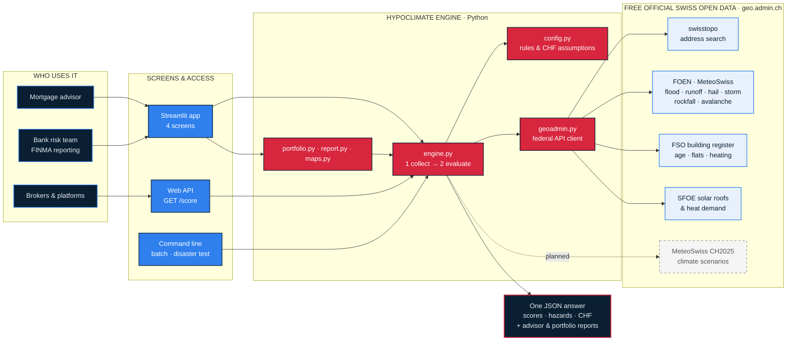
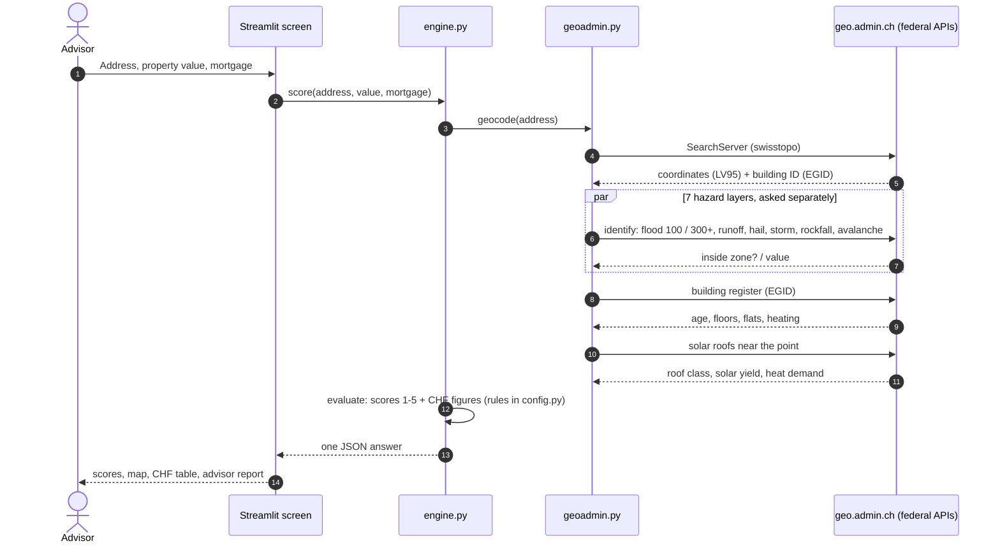
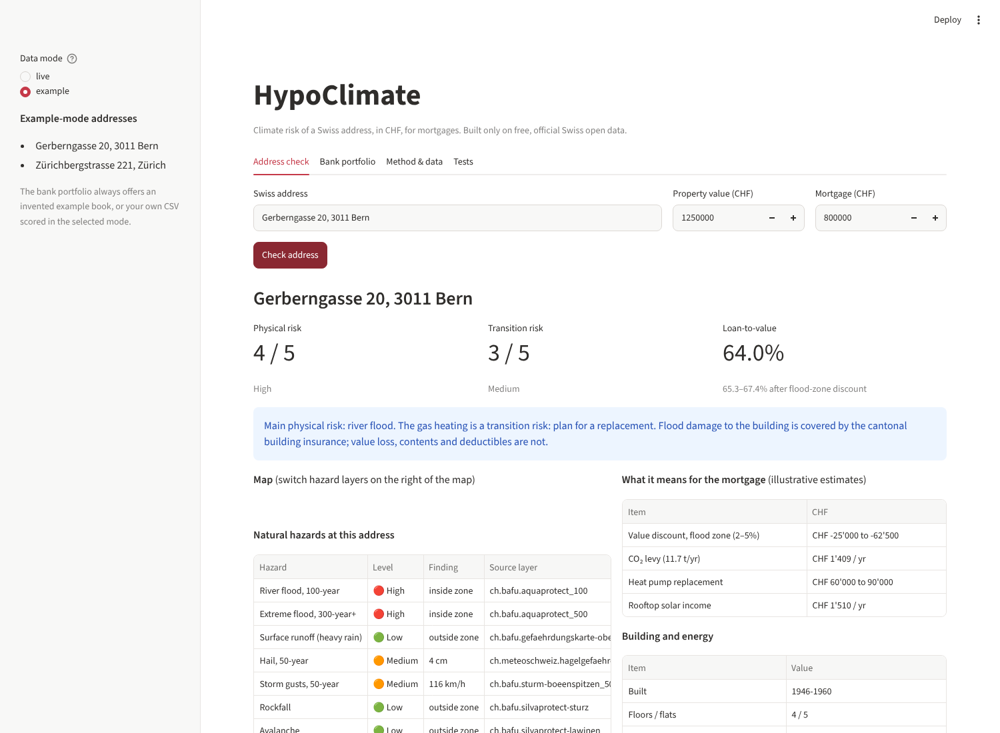
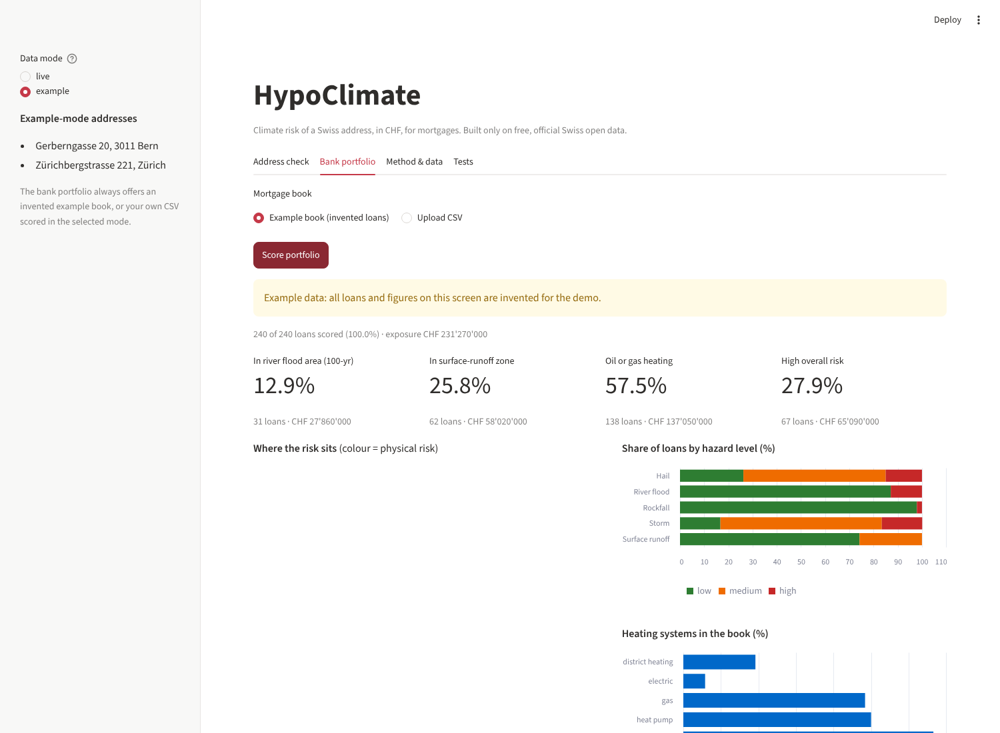
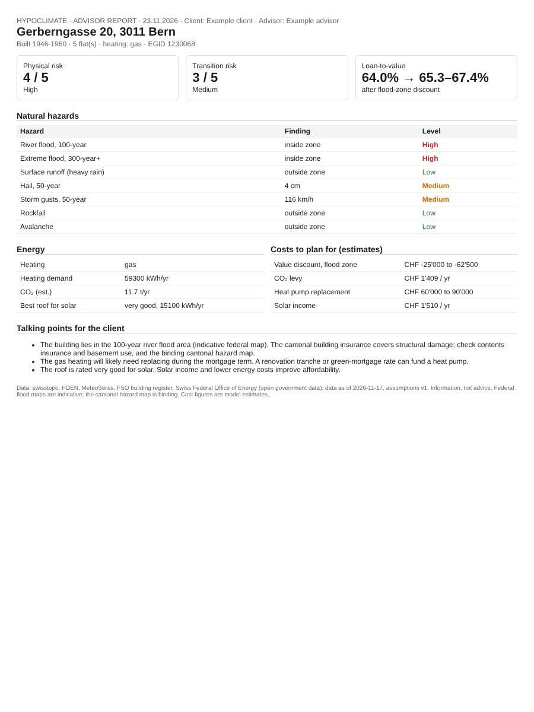
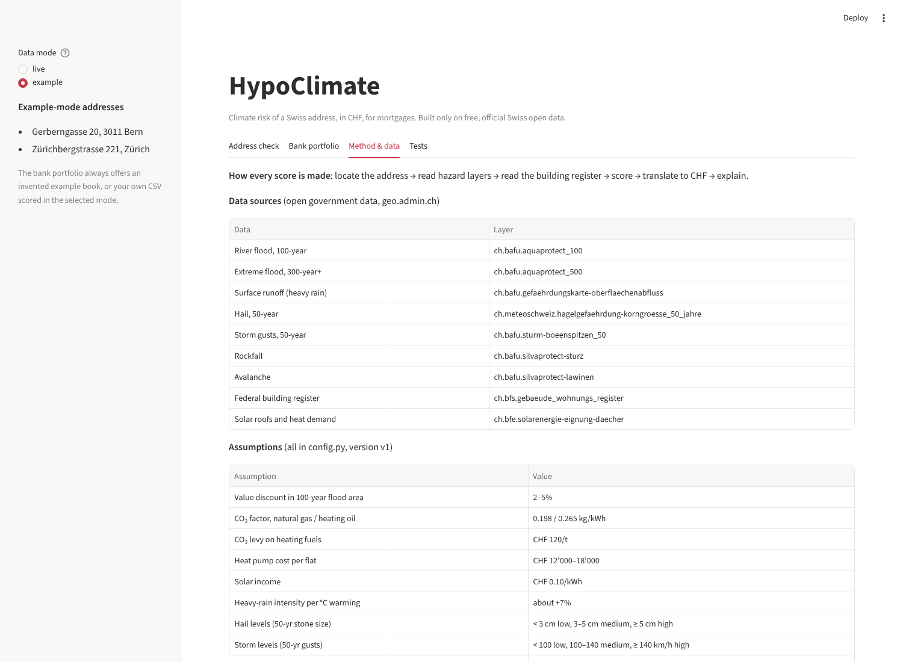
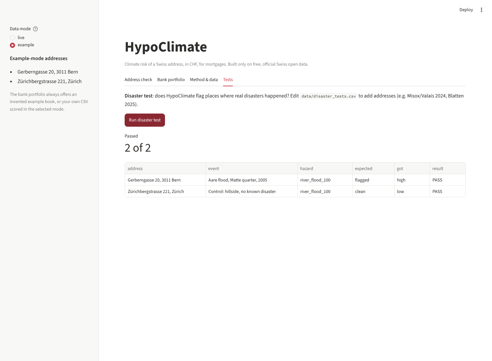

<h1 align="center">🏠🌦️ HypoClimate</h1>

<p align="center">
  <b>Climate risk of any Swiss address, in CHF, for mortgages.</b><br>
  Flood, heavy rain, hail, storm, rockfall and avalanche, plus heating and CO₂, built only on free, official Swiss open data.
</p>

<p align="center">
  
  
  
  
</p>

<p align="center">
  <a href="#quick-start">Quick start</a> &nbsp;·&nbsp; <a href="#architecture">Architecture</a> &nbsp;·&nbsp; <a href="#data">Data</a> &nbsp;·&nbsp; <a href="#screens">Screens</a> &nbsp;·&nbsp; <a href="#cli">CLI</a> &nbsp;·&nbsp; <a href="#configuration">Configuration</a> &nbsp;·&nbsp; <a href="#tests">Tests</a>
</p>

---

<a id="about"></a>

## 🌍 What is HypoClimate?

A user types in a Swiss address. HypoClimate asks several federal data sources about that spot and shows, in one view:

- 🌊 **Natural hazards today**: river flooding, surface runoff after heavy rain, hail, storm, rockfall and avalanches
- 🏢 **The building**: age, flats and heating system from the federal building register, plus roof solar potential
- 🔥 **Transition risk**: how exposed the building is to the move away from oil and gas heating
- 📈 **The 50-year trend**: how heavy rain changes if warming rises
- 💰 **What it means in CHF**: value discount in a flood zone, loan-to-value, CO₂ levy, heat-pump cost, solar income

**Why now:** FINMA Circular 2026/1 "Nature-related financial risks" requires banks to assess climate risks in their mortgage books. In Switzerland, physical damage to buildings is mostly covered by mandatory building insurance, so the real risks for banks and owners are **lost property value, transition costs and uninsured costs**. HypoClimate focuses on exactly these.

<a id="architecture"></a>

## 🏗️ Architecture

One Python engine does all the work. The screens, the web API and the command-line tools only call that engine and show its **one JSON answer**, so every number is calculated in one place.



<details>
<summary><b>The parts and how they connect</b></summary>

| Part | File | Talks to | Job |
|---|---|---|---|
| Screens | `frontend/app.py` | engine, portfolio, report, maps | Address check · Bank portfolio · Method & data · Tests |
| Web API | `backend/api.py` | engine | `GET /score` for brokers, platforms or another front end |
| Command line | `backend/batch.py`, `backend/disaster_test.py` | engine | Score a CSV of addresses; check real disaster places |
| Engine | `backend/engine.py` | geoadmin, config, example data | Step 1 collects facts, step 2 turns them into scores and CHF figures |
| Rules | `backend/config.py` | – | Every threshold and CHF assumption, in one place |
| API client | `backend/geoadmin.py` | geo.admin.ch | Address search, hazard layers, building register, solar roofs |
| Portfolio | `backend/portfolio.py` | engine | Scores a whole mortgage book and sums it up |
| Reports | `backend/report.py` | – | Printable advisor report and portfolio report |
| Maps | `frontend/maps.py` | swisstopo tiles in the browser | Map with switchable federal hazard layers |
| Example data | `backend/example_data.py`, `backend/example_portfolio.py` | – | Offline demo; the example mortgage book is invented |

</details>

### 📁 Folders

| Folder | Branch | What is inside |
|---|---|---|
| `backend/` | `backend` | All logic: federal API client, scoring engine, rules, portfolio, reports, web API, batch and disaster test |
| `frontend/` | `frontend` | Streamlit screens and maps; they only **call** the backend |
| `data/` | `backend` | Two small input files: a sample address list and the disaster-test list |
| `tests/` | both | Automatic tests |

There is **no database**: every check asks geo.admin.ch live, and nothing about a client is stored.

### 🔄 What happens when an advisor checks an address



The seven hazard layers are asked **separately and at the same time**. If one layer fails, only that hazard shows "No data" and the screen names the source that failed.

<a id="data"></a>

## 🗺️ Data sources

All data is official, free and covers all of Switzerland (geo.admin.ch, open government data).

| Data | Provider | Layer | Used for |
|---|---|---|---|
| Address search | swisstopo | SearchServer | Coordinates and building ID (EGID) |
| River flood areas 100 / 300-yr+ | FOEN | `ch.bafu.aquaprotect_100` / `_500` | Flood score |
| Surface runoff | FOEN | `ch.bafu.gefaehrdungskarte-oberflaechenabfluss` | Heavy-rain score |
| Hail size, 50-yr | MeteoSwiss | `ch.meteoschweiz.hagelgefaehrdung-korngroesse_50_jahre` | Hail score |
| Storm gusts, 50-yr | FOEN | `ch.bafu.sturm-boeenspitzen_50` | Storm score |
| Rockfall, avalanche | FOEN | `ch.bafu.silvaprotect-sturz` / `-lawinen` | Mountain hazards |
| Building register | FSO | `ch.bfs.gebaeude_wohnungs_register` | Age, flats, heating → transition score |
| Solar roofs and heat demand | SFOE | `ch.bfe.solarenergie-eignung-daecher` | Solar income, CO₂ levy |
| Base map and hazard map layers | swisstopo, FOEN, MeteoSwiss | WMTS / WMS | Maps in the browser |
| Climate scenarios CH2025 | MeteoSwiss & ETH Zurich | download | 50-year trend (planned) |

<a id="screens"></a>

## 🖥️ Screens

| Screen | For | What it shows |
|---|---|---|
| **Address check** | Mortgage advisor | Physical and transition score (1–5), hazards, building and energy, CHF figures, heavy-rain trend, map, advisor report |
| **Bank portfolio** | Bank risk team | Key figures for the whole book, map of loans, hazard levels, heating mix, highest-risk loans, report and CSV export |
| **Method & data** | Everyone, incl. FINMA | Every source and every assumption |
| **Tests** | Project team | Disaster test on real disaster places |

<a id="quick-start"></a>

## ⚡ Quick start

All commands run in a terminal on your laptop, inside the `hypoclimate` folder.

```bash
# 1 · install once
pip install -r requirements.txt

# 2 · start the prototype (opens in the browser)
streamlit run frontend/app.py
```

> [!TIP]
> In the app, choose **live** to query any Swiss address, or **example** to run offline with Gerberngasse 20, 3011 Bern and Zürichbergstrasse 221, Zürich.

<p align="center">
  
</p>

<details>
<summary><b>More screenshots</b></summary>

| Bank portfolio | Advisor report |
|---|---|
|  |  |
| **Method & data** | **Tests** |
|  |  |

</details>

<a id="cli"></a>

## ⌨️ CLI commands

| Command | What it does |
|---|---|
| `streamlit run frontend/app.py` | Start the prototype screens |
| `python -m backend.batch my_addresses.csv results.csv` | Score a CSV (`address, property_value, mortgage`); prints coverage and speed |
| `python -m backend.disaster_test data/disaster_tests.csv` | Check that real disaster places are flagged |
| `uvicorn backend.api:app --reload` | Start the web API; docs at http://127.0.0.1:8000/docs |
| `python -m pytest -q` | Run the automatic tests |

Add `--mode example` to the batch run or the disaster test to run offline.

<a id="configuration"></a>

## ⚙️ Configuration

Every rule and CHF assumption lives in **`backend/config.py`**, so the scoring can be changed without touching the code.

| Rule | Value |
|---|---|
| Value discount in 100-year flood area | 2–5% |
| CO₂ factor, natural gas / heating oil | 0.198 / 0.265 kg/kWh |
| CO₂ levy on heating fuels | CHF 120 per tonne |
| Heat pump cost per flat | CHF 12'000–18'000 |
| Solar income | CHF 0.10 per kWh |
| Heavy-rain intensity per °C warming | about +7% |
| Hail levels (50-yr stone size) | < 3 cm low · 3–5 cm medium · ≥ 5 cm high |
| Storm levels (50-yr gusts) | < 100 low · 100–140 medium · ≥ 140 km/h high |
| Physical score (1–5) | worst hazard (low 1, medium 3, high 4), +1 if two perils are high |
| Transition score (1–5) | oil 4 · gas 3 · electric 3 · wood 2 · district heating 2 · heat pump 1; +1 if built before 1946 |

<details>
<summary><b>The one JSON answer</b></summary>

Every screen and the API use the same answer from `engine.score(address, value, mortgage)`:

```
address, egid, lv95, wgs84,
hazards   { level, finding, source }   per hazard
building  { period, floors, flats, energy_source }
energy    { heat_demand_kwh, roof_class, solar_kwh }
scores    { physical, transition, main_drivers }
chf       { value_discount, ltv_today_pct, ltv_after_pct, co2_levy_per_year,
            heat_pump_cost, solar_income_per_year }
trend_50y, summary, meta { queried_at, mode, assumptions_version, errors }
```

</details>

<a id="tests"></a>

## 🧪 Tests

`python -m pytest -q` runs 11 automatic tests. They check, among other things, that the Bern example gives exactly the figures from our mockup, that one failing data source does not break the rest, and that the reports and the portfolio summary are built correctly.

The **disaster test** (`data/disaster_tests.csv`) checks real places: the Matte quarter in Bern (Aare flood 2005) must be flagged, a hillside control address must come back clean.

<a id="limits"></a>

## ⚠️ Limits

- Federal flood maps are indicative and ignore flood protection; the binding hazard maps are cantonal.
- The runoff layer shows only "in zone or not", not flow depth.
- There is no free property-value data, so the user enters the value.
- The 50-year trend is a simple rule (+7% heavy-rain intensity per °C), not yet the CH2025 dataset.
- The bank portfolio's example book is invented and marked as such everywhere.
- CHF figures are illustrative estimates. **Information, not advice.**

<details>
<summary><b>Project structure</b></summary>

```
hypoclimate/
  backend/                  # branch: backend
    config.py               # every rule and CHF assumption
    geoadmin.py             # federal geodata API client
    engine.py               # collect -> evaluate -> one JSON answer
    example_data.py         # offline example (Gerberngasse 20, Bern)
    batch.py                # score a CSV; coverage and speed
    api.py                  # web API (GET /score)
    report.py               # advisor and portfolio reports (HTML, print to PDF)
    portfolio.py            # mortgage-book scoring and summary
    example_portfolio.py    # invented example mortgage book
    disaster_test.py        # check real disaster places
  frontend/                 # branch: frontend
    maps.py                 # swisstopo map with hazard layers
    app.py                  # Streamlit screens
  data/
    sample_portfolio.csv
    disaster_tests.csv
  tests/                    # automatic tests
  screenshots/
```
</details>

<a id="credits"></a>

## 🙏 Data

Built on open government data from [geo.admin.ch](https://www.geo.admin.ch): swisstopo, the Federal Office for the Environment (FOEN), MeteoSwiss, the Federal Statistical Office (FSO) and the Swiss Federal Office of Energy (SFOE).

<a id="team"></a>

## 👥 Team

UZH seminar *FinTech & InsurTech – Digitalization of the Financial Services Industry* (HS 2026), Group 14:
Marko Caric · Adam Branny · Léonard Matteo Ménard · Alessandro Michele Caputo · Arjun Singh Bhadoria · Alikhan Kharezov
